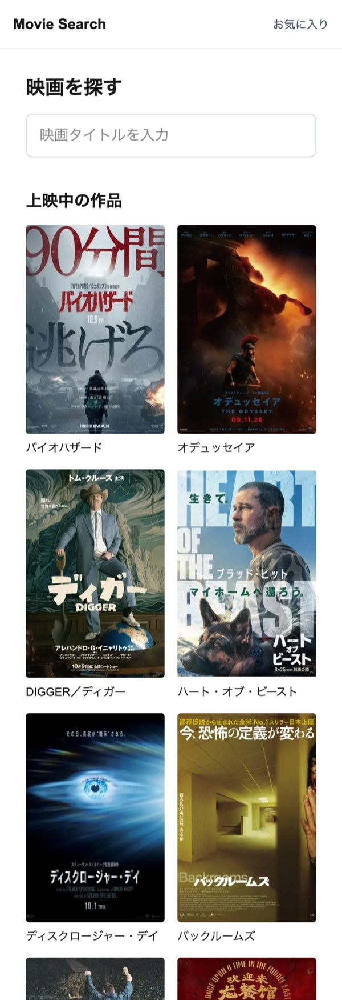
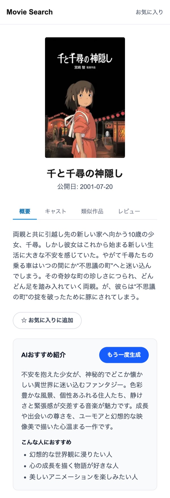

# 映画検索アプリ

TMDB API を利用した映画の検索・詳細閲覧・お気に入り管理に加え、OpenAI API による作品紹介文の自動生成を実装した Webアプリケーションです。

🔗 **デモ**: https://movie-search-app-omega-livid.vercel.app/

  
  

---

## 使用技術

| 分類                 | 技術                                   |
| -------------------- | -------------------------------------- |
| フレームワーク       | Next.js 16（App Router）               |
| 言語                 | TypeScript                             |
| UI                   | React 19 / Tailwind CSS                |
| データ取得・状態管理 | TanStack Query v5                      |
| バリデーション       | Zod                                    |
| 外部API              | TMDB API / OpenAI API（Responses API） |
| データベース         | Neon（PostgreSQL）                     |
| ORM                  | Prisma 7                               |
| 書き込み処理         | Server Actions                         |
| デプロイ             | Vercel                                 |

---

## 主な機能

- **映画検索**: キーワード検索（デバウンス・ページネーション対応）
- **映画詳細**: 「概要／キャスト／類似作品／レビュー」の4タブ構成
- **お気に入り**: 登録／解除と一覧表示（localStorage に保存）
- **AIおすすめ紹介**: 作品紹介文と「こんな人におすすめ」の箇条書きを生成
- **レビュー**: 投稿・一覧・削除（PostgreSQL に保存）

---

## 設計のポイント

- **API キーの保護**: Server Component を基本とし、TMDB・OpenAI はキーをサーバー側だけに置いて Route Handler 経由で呼び出す。AI 生成 API は映画 ID だけを受け取り、OpenAI に渡すあらすじはサーバー側で TMDB から取得する。クライアントから送られた文章を OpenAI に渡さないことで、API を別用途に流用されるのを防いだ。DB は Server Component から Prisma を直接呼び、不要な HTTP 往復を避けた。
- **実行時バリデーション**: TMDB のレスポンス・リクエストボディ・localStorage・レビュー投稿フォームなど、外部データが入る主な境界で Zod の `safeParse` を実施。評価値（1〜5）などの制約もサーバー側の Zod で担保する。
- **キャッシュ戦略**: 映画詳細などは `revalidate: 3600`、検索は `no-store` と、データの性質に応じて `fetch` のキャッシュを使い分けた。
- **タブのレイアウト**: ネストしたレイアウトでポスター・タイトル部分を固定し、タブ移動時はタブ下だけを切り替える。
- **AI 生成**: 構造化出力（`zodTextFormat`）で紹介文と箇条書きを JSON として受け取る。あらすじが未登録の作品では、内容を推測で書かせないよう生成しない。従量課金のためボタン押下時のみ呼び出し、結果は TanStack Query のキャッシュに保持してタブ移動後も再生成せずに表示する。
- **楽観的更新**: レビュー削除は `useOptimistic` で即座に画面へ反映する。
- **アクセシビリティ**: `aria-live` / `aria-pressed` / `aria-current` で状態を伝え、色以外でも判別できるようにした。

---

## 今後の改善予定

- テストコードの追加
- 認証の導入
